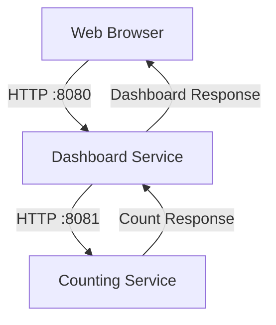

# DB-Counting-Run-in-local

A hands-on project demonstrating how to run a Dashboard Service and a Counting Service locally and how two services communicate over HTTP.

## 📌 Project Overview

This project consists of two services:

- **Dashboard Service:** Provides the web dashboard and retrieves count information from the Counting Service.
- **Counting Service:** Provides counting functionality and returns count information to the Dashboard Service.

The Dashboard Service acts as the client, while the Counting Service acts as its upstream service.

## 🏗️ Architecture



### Service Configuration

| Service | Port | Purpose |
|---|---:|---|
| Dashboard Service | 8080 | Serves the dashboard |
| Counting Service | 8081 | Provides count information |

## 🛠️ Technologies

- Linux executable binaries
- HTTP communication
- Environment variables
- Terminal / Command Line
- Git and GitHub

## 🚀 Getting Started

### Prerequisites

- macOS or a compatible Linux environment
- Terminal access
- Executable binaries compatible with your operating system and CPU architecture

### Step 1: Clone the Repository

```bash
git clone https://github.com/nilarhtun27/DB-Counting-Run-in-local.git
cd DB-Counting-Run-in-local
```

### Step 2: Start the Counting Service

Open a terminal and run:

```bash
cd pov-local
PORT=8081 ./counting-service
```

Keep this terminal running.

### Step 3: Start the Dashboard Service

Open a second terminal and navigate to the project's `pov-local` directory.

```bash
cd pov-local
PORT=8080 COUNTING_SERVICE_URL="http://localhost:8081" ./dashboard-service
```

The Dashboard Service will use port `8080` and connect to the Counting Service on port `8081`.

### Step 4: Access the Dashboard

Open your browser and visit:

**http://localhost:8080**

If both services start successfully and communicate correctly, the dashboard should be accessible.

## 🔄 Request Flow

1. The user opens the dashboard in a web browser.
2. The browser sends an HTTP request to the Dashboard Service on port `8080`.
3. The Dashboard Service requests count information from the Counting Service on port `8081`.
4. The Counting Service processes the request and returns a response.
5. The Dashboard Service uses the response to update the dashboard.

## 🔍 Troubleshooting

| Problem | What to check |
|---|---|
| `Address already in use` | Check whether another process is using the port. |
| `Connection refused` | Confirm the Counting Service is running on port `8081`. |
| Count returns `-1` | Check the service URL, connectivity, and Counting Service response. |
| `Permission denied` | Check executable permissions. |
| Binary cannot run | Verify operating system and CPU architecture compatibility. |

Check whether the ports are in use:

```bash
lsof -i :8080
lsof -i :8081
```

If necessary, make the binaries executable:

```bash
chmod +x pov-local/counting-service pov-local/dashboard-service
```

## 🎯 Learning Objectives

- Understand upstream and downstream service relationships.
- Configure service ports and URLs using environment variables.
- Run multiple services locally.
- Troubleshoot HTTP communication and port conflicts.
- Understand service dependencies before cloud deployment.
- Practice project documentation with GitHub Markdown.

## 📸 Screenshots

Screenshots of the local execution process are available in the `Assignment0-Run-in-local/` directory.

## 📚 What I Learned

Through this project, I practiced running multiple services, configuring communication through environment variables, and troubleshooting service connectivity. This project also provides a foundation for learning cloud deployment, AWS networking, and infrastructure automation with Terraform.

## 👤 Author

**Nilar Htun**

GitHub: [@nilarhtun27](https://github.com/nilarhtun27)
# DB-Counting-Run-in-local
Running Binary in local
